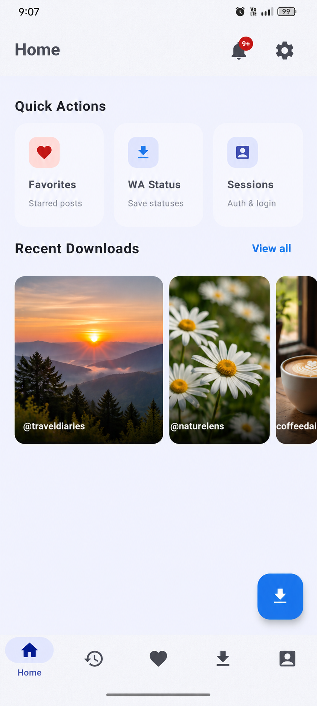
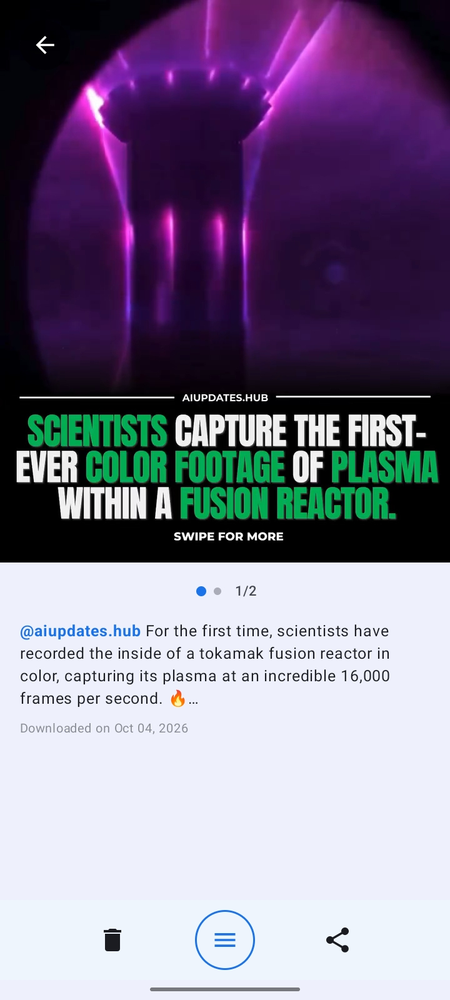
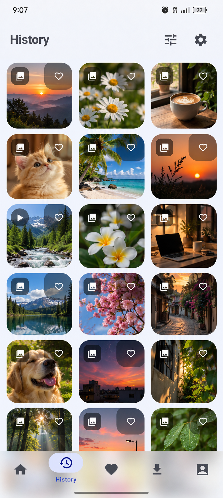
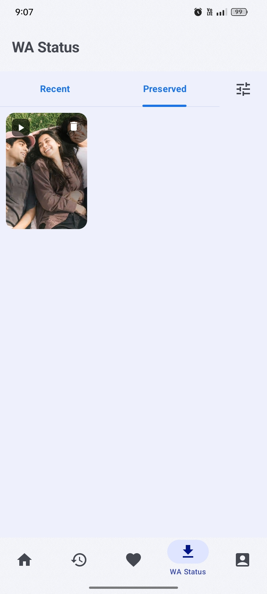
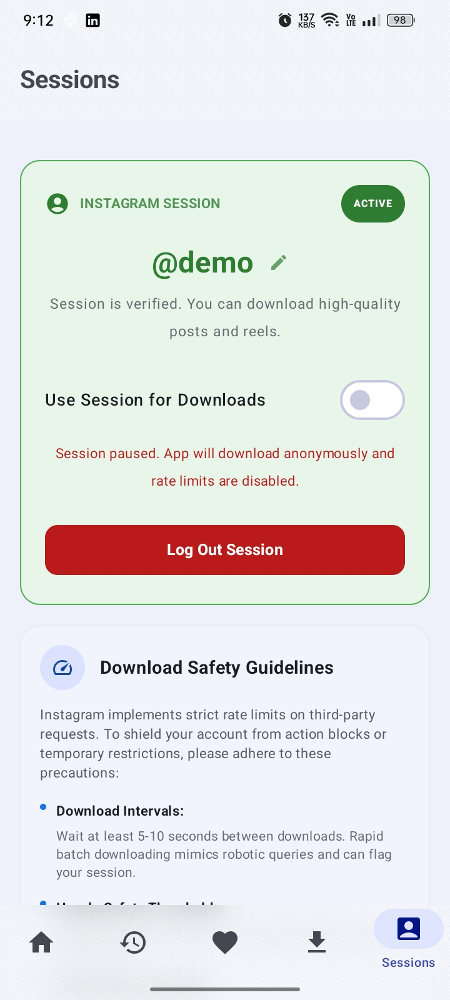
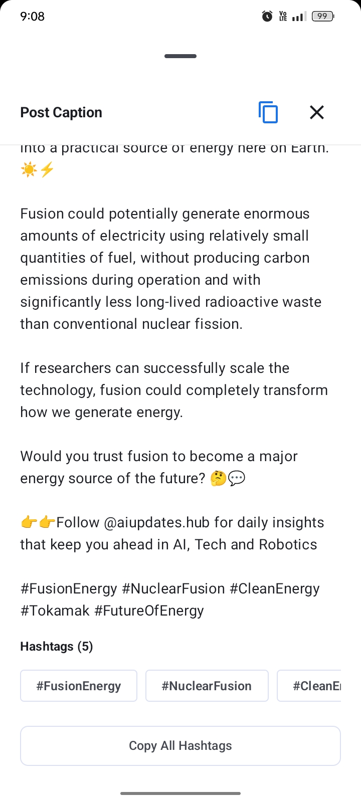
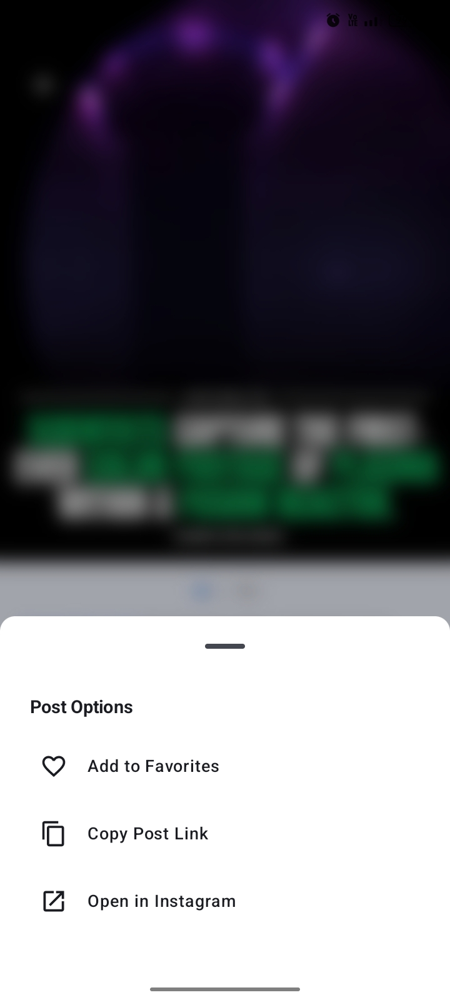

# VedInsta

<p align="center">
  
</p>

<p align="center">
  <strong>A high-performance, native Android media downloader and manager for Instagram.</strong><br />
  Built natively with Kotlin, Jetpack Compose, Material Design 3, and a zero-delay on-device extraction engine.
</p>

<p align="center">
  <a href="https://developer.android.com/about/versions/oreo"></a>
  <a href="https://developer.android.com/"></a>
  <a href="https://kotlinlang.org/"></a>
  <a href="https://developer.android.com/jetpack/compose"></a>
  <a href="https://developer.android.com/topic/architecture"></a>
  <a href="LICENSE"></a>
  <a href="https://github.com/DevSon1024/vedinsta-app/releases"></a>
</p>

---

## Overview

**VedInsta** is an open-source Android application engineered for downloading, organizing, and viewing Instagram posts, reels, carousels, and stories, as well as preserving WhatsApp statuses.

Unlike traditional downloaders that rely on heavy embedded script runtimes or third-party web scrapers that harvest user credentials, VedInsta runs a **100% native Kotlin extraction engine** directly on your device. Every request is serialized with randomized jitter delays, encrypted session handling, and duplicate link protection to preserve account safety and device battery life.

---

## App Screenshots

<div align="center">

### Core Experience & Media Handling

|                            Home Dashboard                             |                          Media Details & Picker                          |                         Offline Download Library                         |
| :-------------------------------------------------------------------: | :----------------------------------------------------------------------: | :----------------------------------------------------------------------: |
|  |  |  |
|      Quick URL paste, live quota indicators, and recent carousel      |     Multi-media selector, high-res previews, and selective downloads     |    Searchable library, multi-select batch actions, and media filters     |

### Utilities & Advanced Tools

|                            WhatsApp Status Saver                             |                           Profile & Stories Handler                            |                             Rich Caption Viewer                              |                            Quick Actions Menu                            |
| :--------------------------------------------------------------------------: | :----------------------------------------------------------------------------: | :--------------------------------------------------------------------------: | :----------------------------------------------------------------------: |
|  |  |  |  |
|              One-tap status saver with 7-day auto-purge worker               |            Story browsing, profile zooming, and favorites tracking             |              Full post caption display with instant tag copying              |      Contextual actions: repost, share, copy link, and browser view      |

</div>

---

## Key Features

- **Native Kotlin Extraction Engine**:
  - High-performance, low-latency parsing using direct GraphQL and JSON endpoints.
  - Zero Python or Chaquopy overhead, delivering instant link resolution and reduced memory footprint.
  - Multi-tier extraction strategy with automated fallback pipelines.

- **Duplicate Link Detection**:
  - Automatically strips tracking parameters (`?igsh=`, `?utm_source=`) and normalizes post shortcodes.
  - Checks the local Room database before triggering network downloads.
  - Alerts users via an interactive dialog offering options to force re-download, copy clean URLs, or dismiss.

- **Material Design 3 & Dynamic Frosted Glass**:
  - High-performance glassmorphism top and bottom app bars powered by the Haze blur engine.
  - User-configurable blur intensity and tint opacity sliders in Appearance settings.
  - True edge-to-edge layout with transparent system bar insets.

- **Immersive Post Viewer**:
  - Fullscreen chromeless media viewer with 5x pinch-to-zoom support.
  - Horizontal swipe locking while zoomed in to prevent accidental paging.
  - Aspect ratio preservation, video player controls, and animated carousel indicators.

- **WhatsApp Status Saver (WAPreserver)**:
  - Separate dedicated tab to browse and save temporary WhatsApp photo and video statuses.
  - Automated WorkManager background cleanup that purges cached status media after 7 days to preserve storage.

- **Quota Manager & Rate-Limit Shield**:
  - Calendar-based download quota controls (hourly, daily, weekly) to prevent account flagging.
  - Serialized downloads with randomized jitter delays (3 to 8 seconds) mimicking natural browsing behavior.

- **Secure Session Management**:
  - Instagram authentication tokens (`sessionid`, `csrftoken`, `ds_user_id`) captured securely via a sandbox WebView.
  - All credentials stored using AndroidX `EncryptedSharedPreferences` (AES-256 GCM).
  - Cookie exports generated strictly in isolated app storage (`filesDir`).

- **Background Services & MediaStore Integration**:
  - Resilient foreground download service providing real-time fraction progress notifications (`X/Y`).
  - Automatic indexing into the Android `MediaStore` for immediate availability in system gallery apps.

---

## Tech Stack & Libraries

| Technology             | Purpose                                                               |
| :--------------------- | :-------------------------------------------------------------------- |
| **Kotlin 2.0+**        | Modern, null-safe language for all application logic                  |
| **Jetpack Compose**    | Declarative, reactive UI toolkit for Android                          |
| **Material 3 (M3)**    | Native Android UI styling, dynamic coloring, and components           |
| **Coroutines & Flow**  | Asynchronous operations, state observation, and thread dispatching    |
| **Room Database**      | Type-safe SQLite abstraction for download history and caching         |
| **OkHttp3 & Retrofit** | High-performance HTTP client for endpoint polling and media streaming |
| **Coil 2.x**           | Fast image and video thumbnail loading with disk and memory caching   |
| **Haze (Chris Banes)** | Real-time blurred frosted-glass effects on Compose app bars           |
| **AndroidX Security**  | EncryptedSharedPreferences (AES-256 GCM) for authentication cookies   |
| **WorkManager**        | Guaranteed background execution for cache maintenance and purging     |

---

## Setup & Build Instructions

Follow these steps to set up, build, and run the project locally.

### 1. Prerequisites

- **Android Studio**: Android Studio Ladybug (2024.2+), Koala, or Hedgehog
- **Java Development Kit**: JDK 17 or JDK 21
- **Android SDK**: API Level 36 (Minimum SDK: 26, Target SDK: 36)
- **Git**: Installed and configured on your machine

### 2. Clone the Repository

```bash
git clone https://github.com/DevSon1024/vedinsta-app.git
cd vedinsta-app
```

### 3. Open in Android Studio

1. Launch Android Studio.
2. Select **Open** and navigate to the cloned `vedinsta-app` directory.
3. Allow Android Studio to sync the Gradle project automatically. All libraries are managed via `gradle/libs.versions.toml`.

### 4. Configure Keystore (Optional)

For local development and testing, standard **debug builds** use the default Android debug keystore automatically without any additional configuration.

If you are compiling a signed release APK, create a `keystore.properties` file in the root directory:

```properties
keyAlias=your_key_alias
keyPassword=your_key_password
storeFile=path/to/your/release.keystore
storePassword=your_store_password
```

### 5. Build via Command Line

Run the following Gradle commands in the project root:

```bash
# Clean the build directory
./gradlew clean

# Run local unit tests (UrlSanitizerTest, etc.)
./gradlew test

# Assemble the Debug APK
./gradlew assembleDebug

# Assemble the Release APK (requires keystore configuration)
./gradlew assembleRelease
```

Generated APKs will be located at:
`app/build/outputs/apk/debug/app-debug.apk`

### 6. Install & Run on Device / Emulator

Ensure an Android device or emulator with API Level 26+ is connected:

```bash
# Verify connected devices
adb devices

# Install the debug APK directly
./gradlew installDebug
```

Alternatively, select the `app` configuration in Android Studio and click the **Run** (green triangle) button.

---

## Permissions & Security

VedInsta strictly requests permissions necessary for its intended functionality:

- `INTERNET` & `ACCESS_NETWORK_STATE`: Resolving Instagram endpoints and streaming media files.
- `FOREGROUND_SERVICE` & `FOREGROUND_SERVICE_DATA_SYNC`: Running resilient background downloads that persist when switching apps.
- `POST_NOTIFICATIONS`: Providing live download progress (`X/Y`) and completion alerts (Android 13+).
- `READ_MEDIA_IMAGES` & `READ_MEDIA_VIDEO`: Detecting and indexing downloaded files into the native Android MediaStore.
- `WRITE_EXTERNAL_STORAGE`: Used conditionally for legacy devices (Android 9 and below).

---

## Caution & Legal Disclaimer

> [!WARNING]
> **Important Legal and Account Notice**
>
> - **Personal & Educational Use Only**: VedInsta is developed exclusively as an educational open-source project and personal archiving utility under fair-use principles.
> - **Intellectual Property & Copyright**: Always respect copyright laws, intellectual property rights, and the creators of original content. Do not download, redistribute, or monetize media without explicit permission from the original copyright holder.
> - **Terms of Service**: Automated downloading or scraping may be subject to limitations under Instagram's Terms of Service. The maintainers of VedInsta assume no liability for misuse, account rate limits, temporary suspensions, or violations of third-party policies.
> - **Account Protection**: To minimize account risks, make use of VedInsta's built-in **Quota Manager** and randomized delay features. If accessing private media that requires authentication, consider using an alternative or secondary test account.
> - **Trademark Notice**: VedInsta is an independent third-party project and is **not affiliated with, associated with, authorized by, endorsed by, or in any way officially connected** with Meta Platforms, Inc., Instagram, WhatsApp, or any of their subsidiaries or affiliates.

---

## License

This project is licensed under the **GNU General Public License v3.0 (GPL-3.0)**.

You are free to inspect, modify, and redistribute this software under the terms of the GPL-3.0 license. Any derivative works or distributions must remain open source under the same license terms. See the [LICENSE](LICENSE) file for full details.

---

## Acknowledgments & Credits

- **[InsGet](https://play.google.com/store/apps/details?id=com.shirokovapp.instasave)**: Main design and UI inspiration for the application, inspiring its fluid layout, intuitive media actions, and signature visual aesthetics.
- **[Instaloader](https://github.com/instaloader/instaloader)**: Gratitude to the Instaloader project and its contributors for their research into GraphQL endpoints and query parameter mappings, which provided valuable inspiration for our native Kotlin extraction engine.
- **[Haze](https://github.com/chrisbanes/haze)** by Chris Banes: High-performance frosted-glass blur effects in Jetpack Compose.
- **[Coil](https://github.com/coil-kt/coil)**: Asynchronous media image and video frame rendering for Kotlin & Compose.
- The open-source Android and Kotlin development communities.

---

<p align="center">
  Developed by <a href="https://github.com/DevSon1024">DevSon1024</a>
</p>
